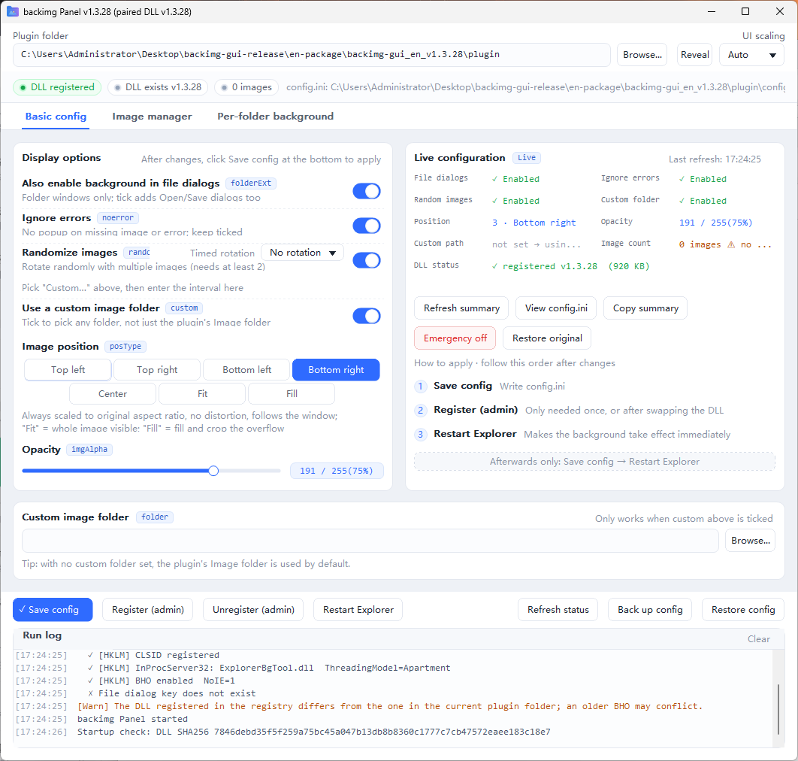

# backimg-gui (backimg Panel)

Lay a custom background image over the folder windows of Windows File Explorer — supports multiple images with random image rotation, second/minute-level timed rotation, aspect-ratio-preserving scaling that follows the window live, and background images in file dialogs.

| Chinese UI (backimg Panel) | English UI (backimg Panel) |
|---|---|
|  |  |

## Downloads (Prebuilt Packages)

Download from [Releases · v1.3.28](https://github.com/vivaqqq/backimg-gui/releases/tag/v1.3.28), unzip and run (contains the backimg Panel exe + DLL + configuration template + documentation):

| Package | UI Language |
|---|---|
| `backimg-gui_v1.3.28.zip` | Chinese |
| `backimg-gui_v1.3.28_english-ui.zip` | English |

The source code for the English UI lives on the [`english-ui`](https://github.com/vivaqqq/backimg-gui/tree/english-ui) branch (`shell/` directory).

> **📌 Honest Disclosure**: This repository — every fix, every feature, and the entire process of open-sourcing it — was **built entirely with AI**. The main workhorse was WorkBuddy (the GLM large language model), with fixes and audits cross-checked over multiple rounds by Qwen, Kimi, DeepSeek, Hunyuan, and Doubao. The repo owner **cannot write code at all** — a zero-code user who only provided requirements, reviewed the results, and pressed "publish". Both the source code and the program are right here under the MIT license — **not satisfied? Feel free to take it home and modify it yourself**. That is exactly what open source is for.

> This project is a deeply enhanced work based on [Maplespe/explorerTool](https://github.com/Maplespe/explorerTool) (MIT License, Copyright © 2021 Maplespe). All capabilities of the original DLL are preserved, with a large number of fixes and feature extensions layered on top. The original author's introduction page: [winmoes.com](https://winmoes.com/tools/12556.html).

## Positioning Statement (Read This First)

- This is the author's **personal modified enhancement build**, provided **AS-IS**: **no maintenance is promised**, and there is no promise to fix any Issue.
- Bug reports with complete logs and PRs are welcome; whether and when anything gets fixed is not guaranteed.
- **Compatibility**: The author develops and tests on real Windows 11 hardware; Windows 10 is a platform supported by the original version, and this branch's changes are concentrated in the GDI+ drawing layer — theoretically compatible but **not tested on real hardware**; real-machine test feedback is welcome.

## Key Enhancements over the Original

| # | Enhancement | Description |
|---|------|------|
| 1 | Image formats expanded to 7 | png / jpg / jpeg / bmp / gif (first frame) / tif / tiff; the original supported only png and jpg |
| 2 | Runtime log | `plugin/ExplorerBgTool_init.log` — troubleshooting is no longer guesswork |
| 3 | Bad-file rejection | Corrupted files disguised as images no longer enter the random pool |
| 4 | Aspect-ratio-preserving scaling + live window following | All seven display positions scale proportionally without distortion; follows dragging/maximizing live; GDI+ bicubic high-quality interpolation; scaling cache |
| 5 | Timed rotation | True random source; supports second-level (e.g. 30 seconds) and minute-level intervals, with each folder window switching images independently |
| 6 | Custom directory self-healing | Lightweight retries when the directory is missing; display recovers automatically once the configuration is back |
| 7 | backimg Panel | Pure C Win32 shell: register/unregister the DLL, select images, tune parameters, restore configuration; embeds the DLL and performs a SHA256 pairing check |

For the full comparison see [docs/feature-comparison.md](docs/feature-comparison.md); for version-by-version change details see [dll/changelog/](dll/changelog/) (14 changelogs plus the master iteration report, v1.3.15 → v1.3.28).

## Build

Requires [MinGW-w64](https://www.mingw-w64.org/) (g++ / gcc / windres).

```bat
:: 1. Build the DLL (output to ..\build\ExplorerBgTool.dll)
cd dll
build.cmd <MinGW-w64 bin directory>

:: 2. Build the backimg Panel (outputs backimg Panel_v1.3.28.exe)
cd ..\shell
build.cmd
```

## Usage

1. Run the backimg Panel as administrator (registering the DLL requires `regsvr32`)
2. Select the image directory → select the display position → save the configuration → restart Explorer
3. For timed image rotation: on the basic configuration page, under "random image rotation", pick a preset or "Custom…", enter a number for minutes/seconds → save → restart Explorer
4. When upgrading, the `exe` and `plugin/ExplorerBgTool.dll` must be **replaced as a pair** (a mismatch in the embedded SHA256 pairing check pops a warning)
5. If a crash occurs: hold `ESC` while opening Explorer (images will not load), then unregister this tool

## Directory Structure

```
├── shell/              backimg Panel source (pure C + Win32)
├── dll/                ExplorerBgTool.dll source (C++, MinHook hooks)
│   └── changelog/      v1.3.15 → v1.3.28 per-version changelogs + master iteration report
├── docs/               original vs. this build feature comparison
└── plugin/
    └── config.ini.example  configuration file template (with Chinese and English comments for every configuration key)
```

## Configuration

For configuration key documentation see [`plugin/config.ini.example`](plugin/config.ini.example); fully compatible with upstream v1.3.25+, and old configuration files can be used directly. After editing, reopen Explorer windows for changes to take effect (no need to restart explorer).

## Known Design Trade-offs (Not Bugs)

- For the five positions "Top-left / Top-right / Bottom-left / Bottom-right / Center": if the image fits, it is placed at original pixel size; only when it does not fit is it scaled down proportionally — small images are never blown up into a blurry mess; to have the image grow with the window, choose the "Scale" position
- "Scale" = the whole image fits the window in full (aspect-ratio-preserving, may leave margins); "Scale and Fill" = fills the window proportionally, centered, cropping the overflow
- Replacing the content of a same-named image requires restarting explorer to take effect (same as upstream)
- Scaling cache memory ceiling semantics: single thread = budget (scaling 32MB / source images 64MB) + the largest single entry; a single oversized image is allowed to stay resident beyond the budget — the worst case is bounded and known

## License

[MIT](LICENSE).

- Original ExplorerBgTool: Copyright © 2021 [Maplespe](https://github.com/Maplespe)
- Modified portions in this repository: also released under the MIT license
